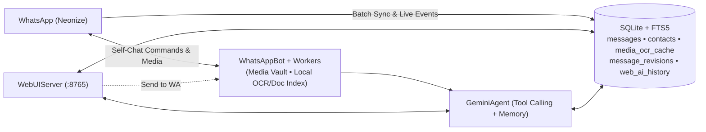

<div align="center">

# WAmate

**Your private WhatsApp "Message yourself" AI Second Brain & Local Explorer.**  
Index every message, photo, voice note, document, link, and deleted text locally in SQLite — query with Gemini AI or browse from a dark-mode Web UI.

[](https://python.org)
[](https://aistudio.google.com/)
[](https://github.com/krypton-byte/neonize)
[](https://sqlite.org/fts5.html)
[](LICENSE)

[Quick Start](#-quick-start) &middot; [Web UI](#-web-second-brain-ui) &middot; [Commands](#-commands) &middot; [Docker](#-docker) &middot; [Privacy](#-privacy--security)

</div>

---

## Why WAmate?

WhatsApp search forgets context, expires media after ~30 days, hides deleted messages, and can't read inside PDFs, Excel sheets, receipts, or voice notes. **WAmate** turns your private **"Message yourself"** chat into a searchable, multimodal memory — without ever replying in anyone else's chat.

- **100% Self-Chat Isolated** — Only responds to commands from *you* in your own "Message yourself" chat (`!ask`, `!get`, `!vault`).
- **Multimodal Gemini + Multi-Key Rotation** — Inspects images, receipts, voice notes, PDFs, Office docs (`.xlsx`, `.docx`, `.pptx`, `.csv`, `.zip`), and links on demand, caching transcripts & OCR in SQLite for instant zero-cost repeats. Auto-rotates `GEMINI_API_KEYS` on `429` limits.
- **30-Day Media Vault + Zero-API Local Indexing** — Pre-downloads media locally with SHA-256 deduplication, extracts document text in pure Python (`ENABLE_LOCAL_DOC_INDEX`), and supports free local CPU OCR (`ENABLE_LOCAL_OCR` via `tesseract`).
- **Anti-Delete & Edit Vault** — Captures real-time Delete-for-Everyone (`REVOKE`) and edits, preserving original wording, revision history, and saved media.
- **Dark Web Second-Brain Explorer** — Local dashboard (`127.0.0.1:8765`) with full-text search, phone/chat & date-range filters, video thumbnails, persistent multi-turn **Ask AI**, one-click **Send to WA**, and password-protected session login.

---

## See It In Action

```text
You:    !ask what did Alex say the Wi-Fi password and keyboard model were?
WAmate: ⏳
        Alex shared the Keychron Q1 Pro in your DM yesterday and mentioned the office Wi-Fi is ... ✅

You:    !get Q3 financial summary pdf
WAmate: 📄 Q3_Financial_Summary_2026.pdf (245 KB) ✅

You:    !deleted Alex
WAmate: 🛡️ 1. 🗑️ Deleted — Alex (14:22) • Original: "Wait, ignore that earlier quote..."
```

> **Tip:** Swipe-reply to *any* photo, PDF, voice note, or message in self-chat with `!ask <question>` or `!get` to act directly on it.

---

## 🌐 Web Second Brain UI

Run WAmate normally (or standalone via `python3 main.py --web-only`) and open **`http://127.0.0.1:8765`**:

- **Search & Media Vault** — FTS5 + cached OCR search across chats, phone numbers (`@lid` resolved), media types, and `From`/`To` date presets (`Today`, `7d`, `30d`), with inline video thumbnails and document text previews.
- **Anti-Delete Vault** — Review deleted/edited messages and saved media (with WhatsApp Status spam filtered out by default).
- **Direct Actions Everywhere** — Click **Ask AI** on any message/file to attach it as context, or **Send to WA** to push it straight back into your WhatsApp self-chat.
- **Persistent AI Workspace** — Clean markdown chat with multi-turn SQLite history restored across refreshes.

<details>
<summary><b>Accessing Web UI on a Remote VPS</b></summary>

Keep `WEB_UI_HOST=127.0.0.1` and tunnel safely over SSH:

```bash
ssh -N -L 8765:127.0.0.1:8765 root@YOUR_VPS_IP
```

Or bind to your server/Tailscale IP and set `WEB_UI_PASSWORD` in `.env` to enable the dark login screen (`HttpOnly` signed session cookie + HTTP Basic Auth for scripts).

</details>

---

## 🚀 Quick Start

### 1. Prerequisites
- **Python 3.12+**, **FFmpeg**, and **SQLite3** (`sudo apt update && sudo apt install -y ffmpeg libmagic1 sqlite3`)
- A free **Gemini API Key** from [Google AI Studio](https://aistudio.google.com/)

### 2. Install & Configure

```bash
git clone https://github.com/y345-git/WAmate.git
cd WAmate
python3 -m venv .venv && source .venv/bin/activate
pip install -r requirements.txt
cp .env.example .env
```

Edit `.env` with your essentials (see `.env.example` for all options):

```ini
GEMINI_API_KEY=AIzaSy...                # Or GEMINI_API_KEYS=key1,key2 for 429 rotation
TZ=Asia/Kolkata                         # Accurate "today" / "yesterday" & date filters
PHONE_NUMBER=                           # Leave blank for QR scan, or set E.164 digits for Pairing Code
WEB_UI_PASSWORD=                        # Recommended if exposing the Web UI beyond localhost
```

### 3. Run & Pair

```bash
python3 main.py
```

Scan the terminal QR code in WhatsApp (**Linked Devices > Link a Device**), or use the 8-digit pairing code if `PHONE_NUMBER` is set. Sessions persist in `data/whatsapp_session.sqlite3`.

---

## 🎮 Commands

### WhatsApp Self-Chat

| Command | Purpose | Example |
| :--- | :--- | :--- |
| `!ask <question>` | Query chats, OCR receipts, docs, voice notes & follow-ups | `!ask total spent on Uber this month` |
| `!get <query>` | Find and send the original file to self-chat (`!send`, `!doc`) | `!get invoice pdf` |
| `!deleted` / `!edits` | Inspect Anti-Delete Vault records (`!vault [name]`) | `!deleted Rahul` |
| `!clear` | Reset active AI conversation memory (`!new`, `!forget`) | `!clear` |
| `!status` | Show sync counts, stored media, OCR/doc index & DB size | `!status` |
| `!help` | List all self-chat commands | `!help` |
| `!unlink` | Disconnect WhatsApp session (add `delete-data` to wipe DB) | `!unlink` |

### Terminal CLI

```bash
python3 main.py --status      # Print DB, media & index stats without starting the bot
python3 main.py --web-only    # Start only the Web UI (no WhatsApp connection)
python3 main.py --prune-db    # Strip redundant raw BLOBs and VACUUM SQLite
python3 main.py --unlink      # Unlink session (add --delete-data or --reset -y to wipe)
```

---

## 🐳 Docker

```bash
docker compose up -d --build   # Start in background with ./data persisted
docker logs -f wamate          # Scan QR / view pairing code
docker compose down            # Stop container
```

---

## 🏗️ How It Works

<details>
<summary><b>Architecture Diagram & Data Flow</b></summary>



</details>

---

## 🔒 Privacy & Security

- **Local-First Storage:** All messages, contact mappings, cached OCR/transcripts, and media stay on your disk in `./data`. Only the specific excerpts/media inspected during an `!ask` query are sent to Gemini.
- **Strict Isolation:** External 1-on-1 and group chats are indexed read-only; WAmate never sends messages outside your self-chat.
- **Hardened Web UI:** Binds to `127.0.0.1` by default, blocks path-traversal outside `DOWNLOADS_DIR`, and protects access with HMAC-signed `HttpOnly` session cookies when `WEB_UI_PASSWORD` is configured.

---

<div align="center">

Open-source under the [MIT License](LICENSE).

</div>
