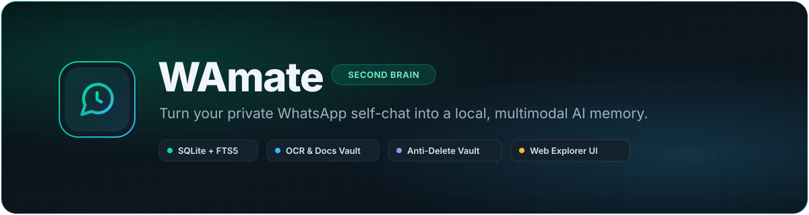
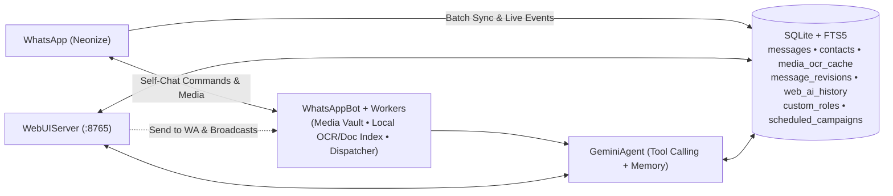

<div align="center">

<a href="#why-wamate">
  
</a>

<br /><br />

[](https://python.org)
[](https://aistudio.google.com/)
[](https://github.com/krypton-byte/neonize)
[](https://sqlite.org/fts5.html)
[](#-docker)
[](LICENSE)

<br />

**[Quick Start](#-quick-start)** &nbsp;&middot;&nbsp; **[Web Studio](#-web-second-brain--campaign-studio)** &nbsp;&middot;&nbsp; **[Commands](#-commands)** &nbsp;&middot;&nbsp; **[Docker](#-docker)** &nbsp;&middot;&nbsp; **[Privacy](#-architecture--privacy)**

</div>

---

## Why WAmate?

WhatsApp search forgets context, expires files after ~30 days, hides deleted messages, and lacks segmented broadcast tools. **WAmate** transforms your personal WhatsApp into a private AI second brain and campaign powerhouse — indexing everything locally while keeping your personal self-chat as your primary command center.

<table>
  <tr>
    <td width="50%" valign="top">
      <h4>🔒 100% Self-Chat Command Center</h4>
      <p>Triggers exclusively on your own messages in <b>"Message yourself"</b>. External DMs and group chats remain strictly read-only.</p>
    </td>
    <td width="50%" valign="top">
      <h4>⚡ Multimodal Gemini + Key Rotation</h4>
      <p>Reads photos, receipts, voice notes, PDFs, and URLs on demand — caching results in SQLite with auto-rotation across <code>GEMINI_API_KEYS</code> on quota limits.</p>
    </td>
  </tr>
  <tr>
    <td width="50%" valign="top">
      <h4>📢 Role-Based Broadcasts &amp; Live Tracking</h4>
      <p>Segment contacts and groups by custom colored roles (<i>VIP, Clients, Family</i>). Send personalized messages (<code>{name}</code>) with anti-spam pacing and a live delivery progress feed.</p>
    </td>
    <td width="50%" valign="top">
      <h4>⏱️ Scheduled Messages &amp; Excel Sync</h4>
      <p>Plan future broadcasts with background cron dispatching. Full backup &amp; restore of contacts, groups, and role mappings via multi-sheet <code>.xlsx</code> workbooks.</p>
    </td>
  </tr>
  <tr>
    <td width="50%" valign="top">
      <h4>💾 30-Day Media Vault &amp; Zero-API Index</h4>
      <p>Auto-downloads media with SHA-256 deduplication, indexes documents in pure Python (<code>ENABLE_LOCAL_DOC_INDEX</code>), and supports optional free local OCR via <code>tesseract</code>.</p>
    </td>
    <td width="50%" valign="top">
      <h4>🛡️ Anti-Delete &amp; Edit Vault</h4>
      <p>Captures real-time Delete-for-Everyone (<code>REVOKE</code>) events and message edits, preserving original text, timelines, and media files.</p>
    </td>
  </tr>
</table>

---

## See It In Action

```text
You:    !ask what was the model of mechanical keyboard Alex shared yesterday?
WAmate: ⏳
        Alex shared the Keychron Q1 Pro (aluminum knob, hot-swappable) in your DM yesterday. ✅

You:    !get Q3 financial summary pdf
WAmate: 📄 Q3_Financial_Summary_2026.pdf (245 KB) ✅

You:    !deleted Alex
WAmate: 🛡️ 1. 🗑️ Deleted — Alex (14:22) • Original: "Hold off on sending that invoice..."
```

---

## 🌐 Web Second Brain & Campaign Studio

Launch WAmate (or run standalone via `python3 main.py --web-only`) and visit **`http://127.0.0.1:8765`**:

- **Search & Media Vault** — Tokenized FTS5 + OCR search across messages and phone numbers (`@lid` resolved), date filters (`Today`, `7d`, `30d`), video thumbnails, and PDF/doc previews.
- **Anti-Delete Vault** — Real-time log of deleted and edited messages (status broadcasts filtered out).
- **Broadcast & Campaign Manager** — Target audience by scope (*All, Contacts Only, Groups Only*) and custom roles with instant live recipient previews and targeting counter badge. Supports `{name}`, `{first_name}`, and `{phone}` personalization, media attachments, and anti-spam delivery pacing (1.0s – 2.5s randomized jitter).
- **Live Delivery Modal & Background Tracking** — Real-time progress bar with per-recipient status feed, floating bottom capsule indicator for dismissible background broadcasts, and page reload resilience.
- **Scheduled Campaign Dispatcher** — Schedule campaigns with a custom calendar & time picker, quick presets (`+30m`, `+1h`, `+3h`, `Tonight`, `Tomorrow`), live recipient preview list, and manageable queue with instant "Send Now" trigger.
- **In-Depth Campaign History & Audit** — Comprehensive execution logs showing start and end timestamps, total duration, delivery pacing rate, success rates, full message payload, and searchable per-recipient audit feed.
- **Excel Backup & Restore** — Export and import your entire address book, groups, and color-coded role tags using formatted `.xlsx` workbooks (Merge or Replace modes).
- **One-Click Actions** — Click **Ask AI** on any bubble or card to query Gemini, or **Send to WA** to push items straight into your WhatsApp self-chat.

<details>
<summary><b>Remote VPS Access (SSH Tunnel or Password Auth)</b></summary>

Keep `WEB_UI_HOST=127.0.0.1` and tunnel securely over SSH:

```bash
ssh -N -L 8765:127.0.0.1:8765 root@YOUR_VPS_IP
```

To expose behind Tailscale/HTTPS, set `WEB_UI_PASSWORD` in `.env` to enable the dark login screen (`HttpOnly` HMAC-signed session cookies + HTTP Basic Auth for scripts).

</details>

---

## 🚀 Quick Start

```bash
# 1. Install system deps (Ubuntu/Debian) & clone
sudo apt update && sudo apt install -y ffmpeg libmagic1 sqlite3
git clone https://github.com/y345-git/WAmate.git && cd WAmate

# 2. Setup Python environment
python3 -m venv .venv && source .venv/bin/activate
pip install -r requirements.txt
cp .env.example .env
```

Add your essentials to `.env` (see [`.env.example`](.env.example) for all flags):

```ini
GEMINI_API_KEY=AIzaSy...        # Or GEMINI_API_KEYS=key1,key2 for 429 quota rotation
TZ=Asia/Kolkata                 # Local timezone for "today", "yesterday" & scheduling
PHONE_NUMBER=                   # Blank = QR scan; E.164 digits = 8-character pairing code
WEB_UI_PASSWORD=                # Set password to protect Web UI on external IPs
```

Start WAmate and scan the QR code (**WhatsApp &rarr; Linked Devices &rarr; Link a Device**):

```bash
python3 main.py
```

---

## 🎮 Commands

### WhatsApp Self-Chat

| Command | Action | Example |
| :--- | :--- | :--- |
| `!ask <question>` | Search chats, OCR receipts, docs & voice notes | `!ask total Uber spend this month` |
| `!get <query>` | Find and deliver the actual file to self-chat (`!send`, `!doc`) | `!get tax invoice pdf` |
| `!deleted` / `!edits` | Browse Anti-Delete Vault entries (`!vault [name]`) | `!deleted Rahul` |
| `!clear` | Reset active AI conversation memory (`!new`, `!forget`) | `!clear` |
| `!status` | Show sync counts, stored media, OCR/doc index & DB size | `!status` |
| `!help` / `!unlink` | Show commands or disconnect WhatsApp session | `!help` |

### Terminal CLI

```bash
python3 main.py --status      # Print DB, media & index stats without starting the bot
python3 main.py --web-only    # Start only the Web UI (no WhatsApp connection)
python3 main.py --prune-db    # Strip redundant raw BLOBs and VACUUM SQLite
python3 main.py --unlink      # Unlink session (add --delete-data or --reset -y to wipe)
```

---

## 🐳 Docker

```bash
docker compose up -d --build   # Run in background with ./data persisted
docker logs -f wamate          # Scan QR / view pairing code
docker compose down            # Stop container
```

---

## 🏗️ Architecture & Privacy

<details>
<summary><b>View Architecture Diagram</b></summary>



</details>

- **Local-First:** Chat history, contacts, cached OCR/transcripts, and media stay on your disk in `./data`. Only the specific context inspected during an `!ask` query goes to Gemini.
- **Strictly Read-Only Elsewhere:** External 1-on-1 and group chats are indexed locally and never receive automated messages unless explicitly broadcasted by you from the Web UI.
- **Delivery Safety:** Broadcasts enforce LID session resolution and configurable randomized delay pacing (1.0s – 2.5s) to avoid spam flags.
- **Locked-Down Web UI:** Binds to `127.0.0.1` by default, blocks path traversal outside `DOWNLOADS_DIR`, and protects access with `HttpOnly` signed cookies when `WEB_UI_PASSWORD` is configured.

---

<div align="center">

Open-source under the [MIT License](LICENSE).

</div>