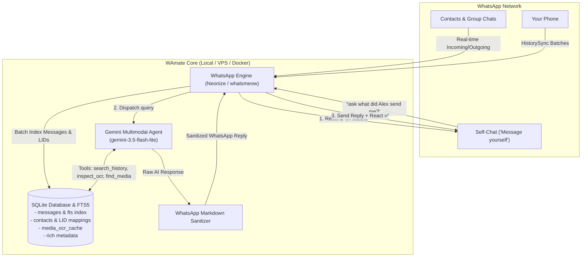

# 🤖 WAmate - WhatsApp Self-Chat AI Second Brain

<p align="center">
  
  
  
  
  
  
</p>

**WAmate** transforms your personal WhatsApp **"Message yourself" (You / Self-Chat)** into a blazing-fast, multimodal AI second brain. 

Operating **strictly inside your private self-chat**, WAmate captures, indexes, and organizes your entire WhatsApp ecosystem—messages, voice notes, photos, product links, contact cards, polls, and scanned PDFs—and lets you query everything or fetch actual files directly through WhatsApp.

---

### 💬 See It In Action

```text
You: !ask what was the model of mechanical keyboard Alex recommended yesterday?
WAmate: ⏳ [reacts immediately]
WAmate: In your direct chat with Alex yesterday, he shared 3 photos of mechanical keyboards while discussing switch types. The model he recommended is the Keychron Q1 Pro with wireless Bluetooth, hot-swappable switches, and a custom aluminum knob...
WAmate: ✅

You: !get Q3 financial summary
WAmate: ⏳
WAmate: [Delivers the actual PDF file directly to your chat]
📄 Q3_Financial_Summary_2026.pdf (245 KB)
WAmate: ✅

You: !status
WAmate: 📊 WAmate Second Brain Status
• Messages Synced: 28,450
• Contacts & Groups: 1,120 (36 groups)
• History Date Range: 2024-01-10 → 2026-03-15
• Database Size: 48.2 MB
• Sync Status: Fully indexed & Real-time active ✅
```

---

## 🌟 Key Features

* 🔒 **100% Self-Chat Isolation:** Listens **only** in your personal "Message yourself" ("You") chat. Never monitors, snoops on, or sends messages to external contacts or group chats.
* ⚡ **Ultra-Fast Batch Indexing (1,000+ msgs/sec):** High-performance SQLite batch engine syncs tens of thousands of past messages in seconds with a live console progress counter.
* 📄 **Actual Document Delivery (`!get` / `!send`):** Automatically finds files on WhatsApp's network and delivers the real document (`.pdf`, `.docx`, `.xlsx`, etc.) straight into your chat.
* 👁️ **Multimodal AI Vision & Idle OCR Pre-Caching:** Powered by Google Gemini to analyze scanned receipts, handwritten notes, whiteboards, bills, and visual items (clothing colors, objects, payment screenshots). Includes a smart **Idle OCR Background Worker** that automatically pre-indexes recent photos with rate throttling, caching results permanently in SQLite for **0ms queries with zero API costs**.
* 🔗 **Link Preview & Web Metadata Search:** Automatically indexes webpage titles, descriptions, and metadata from shared URLs (GitHub repositories, YouTube videos, Amazon/e-commerce products, technical blogs, news articles), making shared links instantly searchable by topic or keyword.
* 🆔 **Cryptographic WhatsApp LID Resolution:** Automatically cross-references WhatsApp's 15-digit privacy LIDs (`@lid`) against your phone address book, accurately identifying real contact names in group chats.
* ⏳ **Real-Time Visual Feedback:** Reacts immediately with an hourglass **`⏳`** on your message bubble when a query begins, switching to a checkmark **`✅`** once completed.
* 🎙️ **Rich Media Aware:** Indexes voice note durations, videos, images, shared vCard contact cards, and polls with their voting options.
* 📱 **Native WhatsApp Formatting:** Sanitized for mobile displays using native WhatsApp markdown (`*bold*`, `_italics_`, `• bullets`) with zero broken raw markdown headers or unreadable tables.
* 🔑 **Dual Pairing Modes:** Supports instant terminal QR code scanning or headless 8-character pairing codes (`ABCD-1234`) for remote VPS and cloud deployments.

---

## 🎮 Commands & Usage

All commands run directly in your WhatsApp **"Message yourself"** chat:

### 📱 In WhatsApp Self-Chat

| Command | Action | Example |
| :--- | :--- | :--- |
| `!ask <question>` | Ask anything about your messages, chats, or media | `!ask what did Alex message me about the project deadline?` |
| `!get <filename>` | Locate and deliver the real document file directly to you | `!get Q3 financial summary pdf` |
| `!send <filename>` | Alternative trigger to fetch and deliver a file | `!send project roadmap 2026` |
| `!status` / `!stats` | View real-time database stats, message counts, and sync state | `!status` |
| `!unlink` | Unlink current WhatsApp account (keeps message history database) | `!unlink` |
| `!unlink --delete-data` | Unlink account and wipe all databases, sessions, and downloads | `!reset` |

---

### 💻 Terminal CLI Utility Commands

You can manage WAmate directly from your terminal:

```bash
# 1. Print indexing and database statistics without starting the bot
python3 main.py --status

# 2. Unlink account (prompts for confirmation; message history preserved)
python3 main.py --unlink

# 3. Unlink account and wipe all databases and downloaded files
python3 main.py --unlink --delete-data

# 4. Immediate headless reset (skips confirmation prompt; ideal for Docker/scripts)
python3 main.py --reset -y
```

---

## 🏗️ Architecture



---

## 🚀 Quick Start Guide

### 1. Prerequisites
* **Python 3.12+**
* **FFmpeg & SQLite3** (for media operations and audio processing):
  ```bash
  sudo apt update && sudo apt install -y ffmpeg libmagic1 sqlite3
  ```
* A free **Google Gemini API Key** from [Google AI Studio](https://aistudio.google.com/).

---

### 2. Installation

Clone the repository and set up a virtual environment:

```bash
git clone https://github.com/y345-git/WAmate.git
cd WAmate

# Create and activate virtual environment
python3 -m venv .venv
source .venv/bin/activate

# Install dependencies
pip install -r requirements.txt
```

---

### 3. Configuration

Copy the example environment template:
```bash
cp .env.example .env
```

Configure your `.env` file:
```ini
# [REQUIRED] Google Gemini API Key
GEMINI_API_KEY=AIzaSy...your_gemini_api_key_here

# [OPTIONAL] Gemini Model (default: gemini-3.5-flash-lite)
GEMINI_MODEL=gemini-3.5-flash-lite

# [OPTIONAL] Command Prefix in Self-Chat (default: !ask)
COMMAND_PREFIX=!ask

# [OPTIONAL] Phone Number for 8-digit Pairing Code (country code + number, no '+' or dashes)
# e.g., 14155552671 (Leave blank to use console QR code)
PHONE_NUMBER=

# Data & Database Directory
DATA_DIR=./data
TZ=UTC
LOG_LEVEL=INFO

# [OPTIONAL] Idle Background OCR Pre-caching (default: true)
ENABLE_IDLE_OCR=true
IDLE_OCR_LOOKBACK_HOURS=48
IDLE_OCR_DELAY_SECONDS=12
```

---

### 4. Run WAmate

```bash
python3 main.py
```

* **QR Code Pairing (Default):** A clean ASCII QR code will display in your terminal. Open WhatsApp on your phone > **Linked Devices** > **Link a Device** and scan the QR code.
* **Phone Pairing Code:** If `PHONE_NUMBER` is set in `.env`, WAmate prints an 8-character pairing code (e.g. `ABCD-1234`). In WhatsApp, tap **Link with phone number instead** and enter the code.

> [!NOTE]
> Once paired, your authentication session is stored in `data/whatsapp_session.sqlite3`. On restarts, **WAmate reconnects in under 2 seconds without re-scanning**.

---

## 🐳 Docker Deployment (Recommended for VPS)

WAmate includes a containerized setup with volume mapping for databases and persistent sessions.

```bash
# 1. Start the container in background
docker compose up -d --build

# 2. View pairing QR code in container logs
docker logs -f wamate

# 3. Stop the container
docker compose down
```

---

## 💡 Example Queries to Try

Once WAmate completes its initial sync, try these queries in your self-chat:

* **Conversations & Catch-ups:**
  * `!ask summarize my chats from today`
  * `!ask what did Alex tell me about the project deadline yesterday?`
  * `!ask who messaged me about the server maintenance window?`
* **Visual Items, Photos & OCR:**
  * `!ask what was the model of the keyboard Alex shared?`
  * `!ask what is the total amount in the payment receipt screenshot sent by Sarah?`
  * `!ask read the handwritten whiteboard photo sent in Project Alpha group`
* **Documents & Actual Delivery:**
  * `!get client onboarding checklist pdf`
  * `!send the latest contract agreement from Acme Corp`
  * `!ask what are the payment terms mentioned in the vendor agreement document?`
* **Products & Shared Links:**
  * `!ask what all monitor and desk setup links did David share today?`
  * `!ask find the article link for system design sent last week`
* **Contacts & Polls:**
  * `!ask find the contact card for Dr. Smith`
  * `!ask what were the options in the team lunch poll?`

---

## 🔒 Privacy & Local Security

* **Zero Cloud History Storage:** Your message history, contact names, and media stay 100% on your local machine or private server in SQLite.
* **Isolated Triggering:** WAmate ignores messages in all external 1-on-1 and group chats. Only commands issued by **you in your self-chat** trigger the assistant.
* **Safe Repository Defaults:** The `.gitignore` excludes session databases, SQLite message stores, `.env`, and downloaded files.

---

## 🛠️ Troubleshooting & FAQ

<details>
<summary><b>1. FFmpeg warning on startup?</b></summary>
Install FFmpeg on your host system:
<code>sudo apt update && sudo apt install -y ffmpeg</code>
</details>

<details>
<summary><b>2. How do I know when message history is fully synced?</b></summary>
Send <code>!status</code> in your WhatsApp self-chat or run <code>python3 main.py --status</code> in your terminal to see current indexed message counts and date ranges.
</details>

<details>
<summary><b>3. Why are media links older than 30 days failing to download?</b></summary>
WhatsApp media links expire on Meta's CDN after approximately 30 days. WAmate automatically falls back to newer matching files when available.
</details>

---

## 📄 License

This project is open-source and distributed under the [MIT License](LICENSE).
