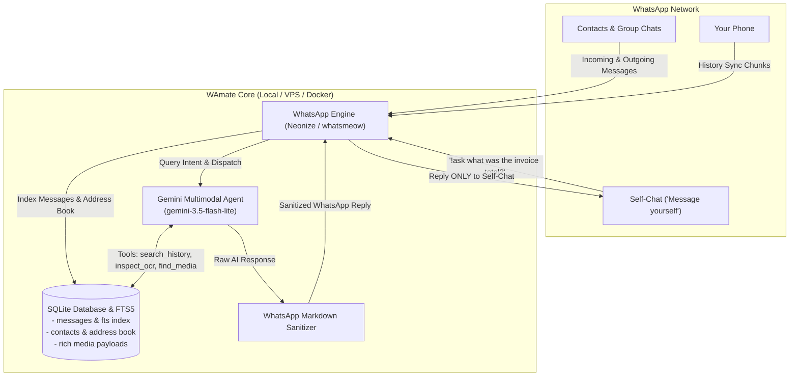

# 🤖 WAmate - WhatsApp Self-Chat AI Second Brain

[](https://www.python.org/downloads/)
[](https://aistudio.google.com/)
[](https://github.com/krypton-byte/neonize)
[](https://www.docker.com/)
[](https://opensource.org/licenses/MIT)

**WAmate** transforms your WhatsApp **"Message yourself" (You / Self-Chat)** into an ultra-fast, multimodal AI second brain. 

Using Google Gemini and local SQLite FTS5 (Full-Text Search), WAmate remembers and organizes your entire WhatsApp history—messages, voice notes, contact cards, polls, photos, and scanned PDFs—and answers questions or sends files right inside your private self-chat.

```text
You: !ask what was the color of kurta that jay shared me yesterday
WAmate: In your direct chat with Jay Patil yesterday, Jay shared 5 photos of kurtas while you discussed colors and embroidery. In these photos, the kurta features an olive-green base with intricate embroidery...

You: !ask send me the latest tax invoice from education group
WAmate: [Sends actual PDF file directly to your chat]
📄 Tax_Invoice_262710021_DCF_Sangli.pdf
```

---

## 🌟 Key Features

* 🔒 **100% Self-Chat Exclusivity:** Listens **only** in your personal "Message yourself" ("You") chat for `!ask`. Never interferes with, snoops on, or replies to external contacts or group chats.
* ⚡ **Lightning Fast Hybrid Search:** Combines SQLite FTS5 full-text indexing, multi-word contact resolution, and smart chat history lookups across 4,000+ contacts and groups.
* 📄 **Actual Document Delivery:** When you ask for an invoice, syllabus, or report, WAmate locates the file on WhatsApp CDN and sends the real document (`.pdf`, `.docx`, etc.) directly into your chat.
* 👁️ **Multimodal AI Vision & OCR:** Uses Gemini Vision to read scanned PDFs, receipts, whiteboard photos, bills, handwritten notes, and clothing items.
* 🎙️ **Rich Media Aware:** Indexes voice note durations, images, videos, shared vCard contact cards, and polls with their voting options.
* 📱 **Native WhatsApp Markdown:** Output is automatically sanitized for mobile screens using native WhatsApp formatting (`*bold*`, `_italics_`, `• bullets`) without ugly raw `#` headers, double asterisks, or broken tables.
* 🔑 **Dual Pairing Options:** Scan a terminal QR code or enter an 8-character phone pairing code (`ABCD-1234`) for headless cloud servers and VPSs.

---

## 🏗️ Architecture



---

## 🚀 Quick Start (Local / WSL / Ubuntu)

### 1. Prerequisites
* **Python 3.12+**
* **FFmpeg** (for audio/video media operations):
  ```bash
  sudo apt update && sudo apt install -y ffmpeg libmagic1 sqlite3
  ```
* A free **Google Gemini API Key** from [Google AI Studio](https://aistudio.google.com/).

---

### 2. Clone the Repository
```bash
git clone https://github.com/y345-git/WAmate.git
cd WAmate
```

---

### 3. Set Up Virtual Environment

Create and activate a clean virtual environment:
```bash
python3 -m venv .venv
source .venv/bin/activate
```

> **Tip for existing setups:** If you already created a virtual environment at `/home/yash/.venvs/wamcpbot`, simply activate that instead:
> ```bash
> source /home/yash/.venvs/wamcpbot/bin/activate
> ```

Install requirements:
```bash
pip install -r requirements.txt
```

---

### 4. Configure Environment Variables

Copy `.env.example` to `.env`:
```bash
cp .env.example .env
```

Edit `.env` with your API key:
```ini
# [REQUIRED] Google Gemini API Key
GEMINI_API_KEY=AIzaSy...your_gemini_api_key_here

# [OPTIONAL] Gemini Model (default: gemini-3.5-flash-lite)
GEMINI_MODEL=gemini-3.5-flash-lite

# [OPTIONAL] Command Prefix (default: !ask)
COMMAND_PREFIX=!ask

# [OPTIONAL] Phone Number for 8-digit Pairing Code (no '+' or dashes)
# e.g., 919876543210 (Leave blank to use terminal QR code)
PHONE_NUMBER=

# Data & Database directory
DATA_DIR=./data
TZ=Asia/Kolkata
LOG_LEVEL=INFO
```

---

### 5. Run the Application

```bash
python3 main.py
```

* **If `PHONE_NUMBER` is left empty:** A QR code will display directly in your console. Open WhatsApp on your phone > **Linked Devices** > **Link a Device** and scan the QR code.
* **If `PHONE_NUMBER` is configured:** An 8-character pairing code (e.g. `ABCD-1234`) will be printed. In WhatsApp, tap **Link with phone number instead** and type in the code.

Once paired, your session is saved in `data/whatsapp_session.sqlite3`. On subsequent restarts, **WAmate reconnects in under a second without re-scanning!**

---

## 🐳 Docker Deployment (Recommended for VPS)

WAmate includes a multi-stage `Dockerfile` and `docker-compose.yml` with persistent volume mapping for sessions and databases.

### 1. Configure `.env`
Ensure your `.env` contains your `GEMINI_API_KEY`.

### 2. Start with Docker Compose
```bash
docker compose up -d --build
```

### 3. View Logs / Scan QR Code
```bash
docker logs -f wamate
```

To stop:
```bash
docker compose down
```

---

## 💬 How to Use WAmate

Open your WhatsApp and go to your **"Message yourself"** chat (the chat with your own phone number or name):

| Command / Query Example | What WAmate Does |
| :--- | :--- |
| `!ask what did Jay message me about yesterday?` | Searches your 1-on-1 chat history with Jay and recaps key points |
| `!ask what was the color of kurta that Jay shared yesterday?` | Checks Jay's chat, finds the photos, and uses AI Vision OCR to describe the kurta |
| `!ask get me the invoices from Education group` | Locates the latest invoices and sends the actual PDF documents directly to you |
| `!ask what does the latest pdf in Education contain?` | Reads the PDF (even scanned PDFs) with multimodal OCR and gives a clean summary |
| `!ask find the contact card for Dr. Patil` | Searches all shared vCard contact cards and returns phone number & details |
| `!ask who messaged me recently about the server downtime?` | Searches across all chats and reports exact timestamps, senders, and quotes |
| `!unlink` | Unlinks current WhatsApp account (preserves saved message database) |
| `!unlink --delete-data` | Unlinks WhatsApp account AND wipes all saved messages, contacts, and media |

---

## 🔄 Unlinking & Switching Accounts

WAmate makes it easy to unlink your account or switch to a new phone number at any time, either directly from WhatsApp chat or via terminal CLI.

### Option 1: Directly from WhatsApp Self-Chat
* **Unlink Account (keep database):**
  Send `!unlink` (or `!logout`) in your self-chat.
* **Unlink & Wipe All Data:**
  Send `!unlink --delete-data` (or `!reset`) in your self-chat.

### Option 2: From the Terminal CLI
```bash
# Unlink account only (prompts for confirmation; message history preserved)
python3 main.py --unlink

# Unlink account and wipe all databases & cached media
python3 main.py --unlink --delete-data

# Fast reset without confirmation prompts (useful for scripts / Docker)
python3 main.py --reset -y
```

Once unlinked, simply run `python3 main.py` to link a brand-new WhatsApp account!

---

## 📂 Project Structure

```text
WAmate/
├── bot/
│   ├── config.py             # Environment configuration & validation
│   ├── database.py           # SQLite FTS5 engine, schema migrations & contact resolution
│   ├── gemini_agent.py       # Google Gemini SDK agent & autonomous tool dispatcher
│   ├── utils.py              # Media parsers, document readers, and WhatsApp markdown sanitizer
│   └── whatsapp_client.py    # Neonize/whatsmeow client event handlers & media downloader
├── data/                     # Local persistent database, sessions, and downloads (git-ignored)
├── .env.example              # Template configuration
├── .gitignore                # Security rules (never commits tokens, sessions, or db)
├── Dockerfile                # Production Docker container definition
├── docker-compose.yml        # Docker compose service setup
├── main.py                   # Application entrypoint
├── requirements.txt          # Python dependencies
└── README.md                 # Documentation
```

---

## 🔒 Privacy & Security

* **Operates Strictly in Self-Chat:** All triggers and responses are strictly isolated to your personal self-chat.
* **Local Data Storage:** Message history, address book caches, and media files are stored strictly on your local machine / server in SQLite (`data/whatsapp_messages.db`).
* **Zero Third-Party Telemetry:** No tracking, telemetry, or external servers are involved except for Google Gemini API calls when answering queries.
* **Safe `.gitignore` by Default:** Session databases, credentials, `.env`, and downloaded files are excluded from Git to prevent accidental leaks.

---

## 🛠️ Troubleshooting

* **Media operations fail / FFmpeg warning:**
  Install ffmpeg on your machine:
  `sudo apt install ffmpeg`
* **Protobuf version warning:**
  Ensure you are using `protobuf>=7.34.0` in your virtualenv (`pip install -r requirements.txt`).
* **Download failed with status code 410:**
  WhatsApp media download links expire on Meta's CDN after ~30 days. WAmate automatically falls back to newer matching files.

---

## 📄 License

This project is licensed under the [MIT License](LICENSE).
